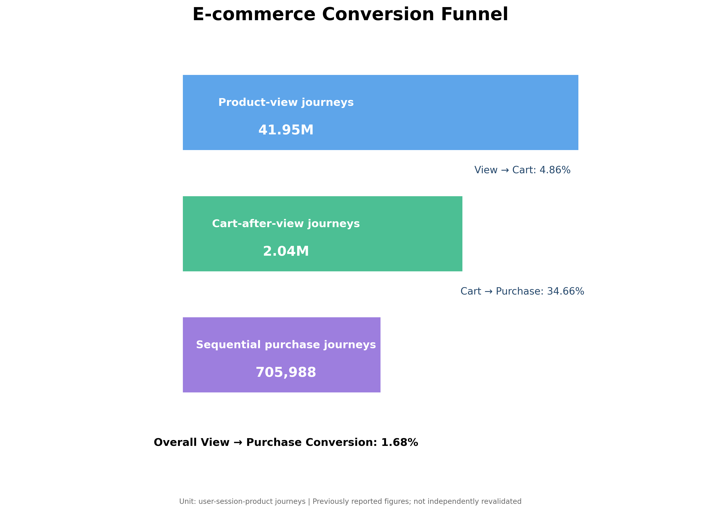

# E-commerce Funnel Analysis | SQL Product Analytics Case Study

**A data-driven investigation of product-view, add-to-cart, and purchase behavior using SQL and DuckDB.**

[](https://duckdb.org/docs/)
[](https://www.python.org/)
[](https://duckdb.org/)
[](https://www.kaggle.com/)

## 1. Project Overview

Why do so many customers who view a product never proceed to purchase?

This project analyzes e-commerce behavioral event data to quantify conversion across three stages of the shopping journey:

**Product View → Add to Cart → Purchase**

Using SQL and DuckDB, I built a sequential funnel, calculated stage-level conversion rates, explored category and brand performance, and identified potential areas for further product investigation.

The objective was not just to calculate metrics, but to translate behavioral data into actionable product hypotheses.

## 2. Business Problem

E-commerce businesses generate large volumes of product interactions, but activity does not necessarily translate into purchases.

Understanding where potential customers drop off can help product teams prioritize investigations into product discovery, product-page usability, pricing, availability, and checkout friction.

**Key business question:** At which stage does the largest observed drop-off occur, and what should the product team investigate first?

## 3. Dataset

- **Dataset:** [eCommerce Behavior Data from Multi-Category Store](https://www.kaggle.com/datasets/mkechinov/ecommerce-behavior-data-from-multi-category-store)
- **Data period analyzed:** November 2019
- **Source:** Kaggle
- **Data type:** E-commerce behavioral event logs

Relevant fields include:

| Column | Description |
|---|---|
| `event_time` | Timestamp of the event |
| `event_type` | Event type, such as view, cart, or purchase |
| `product_id` | Product identifier |
| `category_code` | Product category hierarchy |
| `brand` | Product brand |
| `price` | Product price |
| `user_id` | User identifier |
| `user_session` | Session identifier |

The original dataset is large, so the analysis was performed in a cloud notebook using DuckDB rather than downloading the full dataset locally.

## 4. Tools and Technologies

- **SQL:** Filtering, aggregation, conditional logic, event sequencing, and funnel calculations
- **DuckDB:** Analytical SQL queries over CSV data
- **Python:** Notebook execution and result inspection
- **Kaggle Notebooks:** Cloud-based analysis environment

## 5. Methodology

### Step 1 — Event exploration

Examined event volumes and distinct users across views, cart additions, and purchases to understand the scale and composition of the data.

### Step 2 — Journey definition

Defined a product journey at the following grain:

`user_id + user_session + product_id`

This allows multiple product interactions within the same session to be analyzed separately.

A journey is not equivalent to a unique customer or a unique order.

### Step 3 — Sequential funnel construction

Built a funnel that requires:

1. A product view.
2. A cart event occurring at or after the first view.
3. A purchase event occurring at or after the qualifying cart event.

This is more precise than counting event types without considering their order.

## Funnel Visualization



### Step 4 — Conversion measurement

Calculated the following metrics:

- View-to-cart conversion
- Cart-to-purchase conversion
- Overall view-to-purchase conversion

### Step 5 — Category and brand exploration

Explored conversion differences across categories and brands to identify possible areas for further investigation.

**Validation note:** Category and brand results are exploratory. Their corrected aggregation has not been fully validated, so they are not used as confirmed findings in this report.

## 6. Key Results

The validated sequential funnel for November 2019 produced the following results.

| Funnel metric | Journeys |
|---|---:|
| Product-view journeys | 41,949,801 |
| Cart-after-view journeys | 2,036,785 |
| Sequentially completed journeys | 705,988 |

### Conversion metrics

| Metric | Result |
|---|---:|
| View → Cart | 4.86% |
| Cart → Purchase | 34.66% |
| View → Purchase | 1.68% |

*Rates are rounded to two decimal places. The calculations use product-view journeys as the starting population.*

## 7. Key Insights

### Insight 1 — The largest observed drop-off occurs before adding to cart

Approximately 95.14% of product-view journeys did not progress to a qualifying cart event.

This makes the product-view-to-cart transition a reasonable starting point for further investigation.

Potential factors include product information quality, pricing, product availability, delivery expectations, and add-to-cart usability. These are hypotheses, not proven causes.

### Insight 2 — A smaller share of carted journeys progress to purchase

Approximately 34.66% of journeys with a qualifying cart event progressed to a sequential purchase event.

This suggests a second area worth investigating: cart and checkout friction.

Potential factors include unexpected delivery charges, payment issues, complicated checkout flows, and delivery estimates.

The event data does not independently establish which factor, if any, explains abandonment.

### Insight 3 — Conversion metrics require clear definitions

Counting views, cart events, and purchases independently can produce misleading funnel interpretations.

Defining a journey and enforcing event order provides a more meaningful view of observed progression.

However, a sequential event pattern does not prove that the preceding event caused the purchase.

## 8. Product Recommendations

### Recommendation 1 — Investigate product-page performance

Examine product-page exits, add-to-cart interactions, pricing, stock availability, delivery information, and mobile usability.

**Primary metric:** View-to-cart conversion rate.

### Recommendation 2 — Investigate cart abandonment

Review checkout steps, shipping charges, payment failures, delivery estimates, and unexpected costs.

**Primary metric:** Cart-to-purchase conversion rate.

### Recommendation 3 — Test a targeted product improvement

Design a controlled experiment around a specific product-page or checkout hypothesis.

For a product-page experiment, use view-to-cart conversion as the primary metric and purchase conversion as a secondary metric. Define an appropriate experiment duration, sample size, and guardrail metrics before launch.

No conversion uplift is claimed because no controlled experiment has been conducted.

## 9. Limitations

- The analysis covers November 2019 and may not reflect current e-commerce behavior.
- The funnel measures product-session journeys, not unique customers or orders.
- Repeated events and multiple journeys from the same user can affect interpretation.
- Sequential event progression does not establish causality.
- Missing category or brand values may affect category-level analysis.
- Category and brand aggregation requires further validation.
- Revenue, profit, returns, and checkout-specific friction have not been quantified in this analysis.

These limitations should be considered before using the findings to make business decisions.

## 10. Project Structure

The repository is intended to contain the following materials as they are finalized:

```text
SQL-focused-Product-Analytics-case-study/
├── README.md
├── sql/
│   ├── event_exploration.sql
│   ├── funnel_analysis.sql
│   └── category_analysis.sql
├── notebooks/
│   └── ecommerce_funnel_analysis.ipynb
├── visuals/
│   └── funnel_chart.png
└── reports/
    └── project_report.pdf
```

File names above describe the proposed organization; not all files may be present yet.

## 11. Reproducibility

The original dataset is available on [Kaggle](https://www.kaggle.com/datasets/mkechinov/ecommerce-behavior-data-from-multi-category-store).

To reproduce the analysis:

1. Open the dataset page and add the dataset to a Kaggle Notebook.
2. Install DuckDB if it is not already available.
3. Configure the CSV file path for the November 2019 data.
4. Run the SQL queries in the notebook.
5. Compare the output against the funnel definitions and reported metrics in this README.

The full raw dataset is not included in this repository because of its size.

## 12. Conclusion

This project demonstrates how SQL can be used to turn raw behavioral events into a structured conversion funnel.

The validated results highlight the product-view-to-cart transition as the largest observed drop-off and provide a basis for further investigation into product-page performance and checkout friction.

The next analytical step is to validate category-level differences, investigate the underlying causes, and test targeted improvements using measurable product metrics.

---

**Project focus:** Product Analytics · SQL · Funnel Analysis · Conversion Metrics · Business Problem-Solving

**Author:** [Hrishit Saha](https://github.com/hrishit06)
